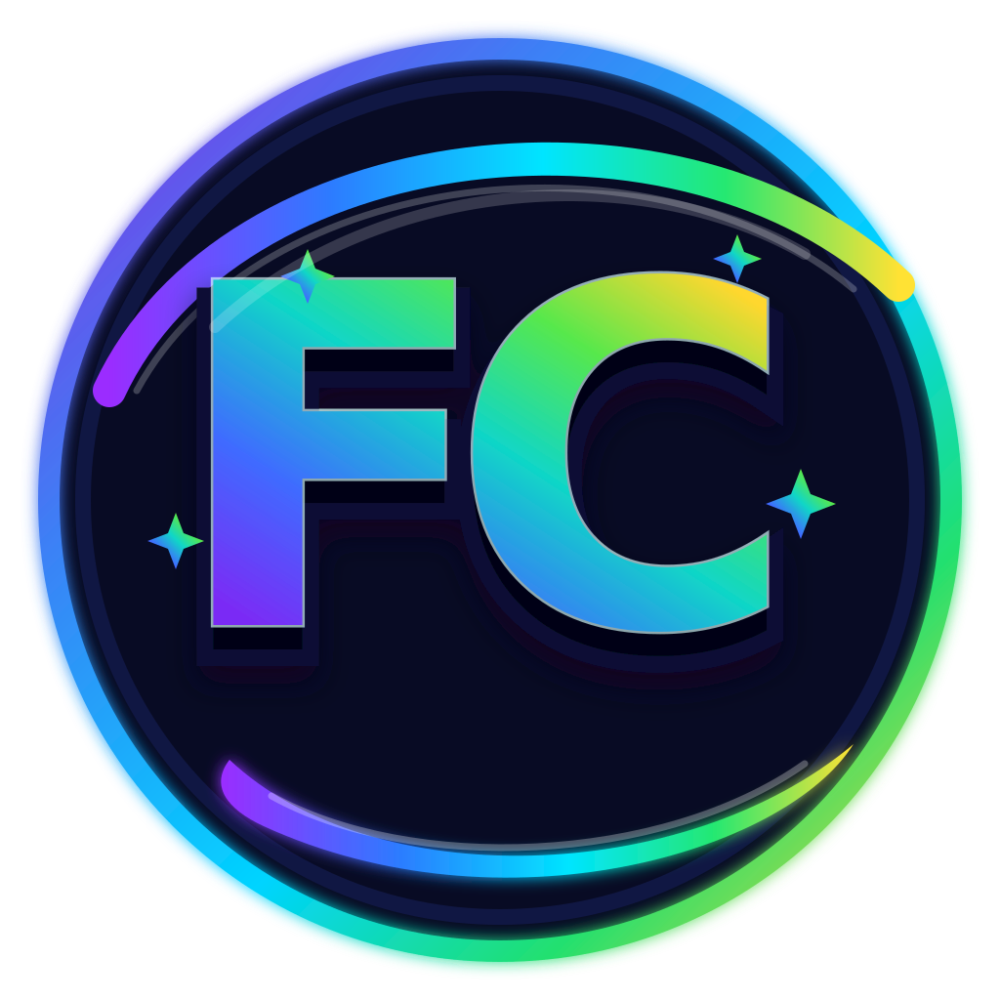

<div align="center">

# 🏆 Flashcard Champ

### 🎮 Learn • Play • Practise • Grow!

**A fun, interactive learning platform that turns everyday classroom practice into an engaging game for primary-school learners.**



<br />


**Designed for young learners | Built with simple web technologies | Teacher-friendly content management**

</div>

---

## 🌟 What is Flashcard Champ?

Flashcard Champ is a browser-based educational game for **Classes 1–5**. It helps children practise concepts through colourful, interactive questions instead of routine question-answer practice.

Learners follow a simple journey:

<div align="center">

**🏫 Choose Class** &nbsp; ➜ &nbsp; **📚 Select Subject** &nbsp; ➜ &nbsp; **🧩 Pick Topic** &nbsp; ➜ &nbsp; **🎯 Choose Difficulty** &nbsp; ➜ &nbsp; **🚀 Play!**

</div>

Students can answer by tapping, matching, arranging, dragging and identifying pictures. Teachers can use the built-in **Admin Panel** to create and manage learning content and customise the classroom experience.

---

## ✨ Key Features

<table>
<tr>
<td width="50%" valign="top">

### 🎮 For Students

- 🧠 Interactive, tap-to-answer questions
- 🎲 Multiple question and activity formats
- 🏅 Points, lives, timer and streaks
- 🔊 Sound feedback and result summaries
- 🔀 Shuffled questions and answer choices
- 🖼️ Picture-based learning activities
- 🌐 Hindi and English question content
- 📱 Responsive layout for phones, tablets, laptops and interactive panels

</td>
<td width="50%" valign="top">

### 🧑‍🏫 For Teachers

- ✍️ Visual Question Builder with live preview
- 📚 Question Library with search and filters
- 🏫 Class and Subject Manager
- 🗂️ Topic Manager
- 🖼️ Image browser and local image preview
- 🎨 School branding, theme and game settings
- 📥 Import and 📤 Export question data
- 💾 Backup and Restore local Admin data
- 📖 Built-in Help guide

</td>
</tr>
</table>

---

## 🧩 Supported Question Types

Flashcard Champ currently supports **11 question formats**:

| # | Activity | # | Activity |
|---:|---|---:|---|
| 1 | ✅ Multiple Choice (MCQ) | 7 | 🔢 Arrange in Order |
| 2 | 🎯 Choose the Answer | 8 | 🧲 Drag & Drop |
| 3 | ✔️ True or False | 9 | 🖼️ Image Based |
| 4 | 👍 Yes or No | 10 | 🌄 Image MCQ |
| 5 | 🕵️ Odd One Out | 11 | 👀 Identify the Picture |
| 6 | 🔗 Match the Pairs |  |  |

See [`sample-all-question-types.json`](sample-all-question-types.json) for examples of the supported formats.

---

## 📊 Current Question Bank

The current project archive includes **43 topics and 1,821 questions**, listed in `data/manifest.json`.

| Class | Number of Questions |
|:---:|---:|
| Class 1 | 304 |
| Class 2 | 300 |
| Class 3 | 596 |
| Class 4 | 521 |
| Class 5 | 100 |
| **Total** | **1,821** |

> ℹ️ The available subjects and topics may differ from class to class. The app displays the content available in the bundled question bank and locally added catalogue. Check `data/manifest.json` for the exact topic list.

---

## 🚀 Run Flashcard Champ Locally

Flashcard Champ is a **static web project**. No npm installation or build command is needed for normal use.

### 1️⃣ Get the project

Download the repository or clone it:

```bash
git clone https://github.com/Thedarkgeekdc2/FCGAMES.git
cd FCGAMES
```

### 2️⃣ Start a local web server

Run this command from the folder containing `index.html`:

```bash
python -m http.server 8000
```

### 3️⃣ Open in your browser

Visit:

```text
http://127.0.0.1:8000/
```

> 💡 **Important:** Use a local web server instead of opening `index.html` directly with `file://`. The app loads JSON data using the browser's `fetch` function, which may be blocked when opening files directly.

---

## 🌐 Publish on GitHub Pages

You can host Flashcard Champ as a static website using GitHub Pages.

1. Create or open the GitHub repository for Flashcard Champ.
2. Upload the **contents of the `FC/` project folder** to the repository root. Files and folders such as `index.html`, `admin/`, `data/`, `js/`, `styles/` and `.nojekyll` should be at the top level.
3. Commit and push the files to your selected branch, such as `main`.
4. Open **Settings → Pages** in your repository.
5. Under **Build and deployment**, select **Deploy from a branch**.
6. Select your branch and choose `/(root)` as the folder, then save.
7. Open the website URL provided by GitHub Pages.

> ✅ Keep the `.nojekyll` file in the repository root. The project uses relative asset paths and can be hosted as a GitHub Pages project site or a user/organisation site.

---

## 🧑‍🏫 Teacher Admin Panel

Open the published website and select **Admin**, or visit:

```text
/admin/login.html
```

After signing in, use the Dashboard to access the available management tools. The in-app **Help** page provides guidance for common tasks.

### 🛠️ Admin Tools at a Glance

| Tool | What you can do |
|---|---|
| ✍️ Question Builder | Create questions using a visual form and preview them on the student side. |
| 📚 Question Library | Search, filter, edit and delete questions. |
| 🏫 Classes & Subjects | Manage the classes and subjects shown in the app. |
| 🗂️ Topic Manager | Add and manage topics under each class and subject. |
| 🖼️ Images | Browse question images, check paths and preview a local image. |
| 🎨 Settings | Customise school branding, footer text, theme and game rules. |
| 📦 Import / Export | Import question JSON and export teacher-created questions. |
| 💾 Backup / Restore | Download a backup of local Admin data and restore it when required. |
| 📖 Help | Read the in-app guide. |

### 🔐 Important Security Notice

Flashcard Champ is a **client-side static website**. The Admin login is a basic classroom-level access barrier; it is **not secure authentication**. Credentials are checked in browser-side code using the public configuration file `config/admin-config.json`, which visitors can inspect. Changing the password does not make it server-secured.

- Do not use this login to protect confidential information.
- Do not store sensitive student or personal data in this project.
- A genuinely secure teacher login requires a trusted backend or authentication service.

---

## ➕ Add a New Question Topic

Question files are organised by class and subject:

```text
data/
├── class-1/
│   ├── hindi/
│   ├── english/
│   ├── maths/
│   └── gk/
├── class-2/
├── class-3/
├── class-4/
├── class-5/
└── manifest.json
```

### 📝 Step 1 — Create a question file

Create a `.json` file inside the correct class and subject folder. Example:

```text
data/class-3/maths/multiplication-practice.json
```

### 🧾 Step 2 — Add the question data

Use the required class, subject, topic and question structure. For example:

```json
{
  "class": 3,
  "subject": "Maths",
  "topic": "Multiplication Practice",
  "questions": [
    {
      "id": "class3-maths-mul-001",
      "type": "mcq",
      "question": "What is 6 × 4?",
      "options": ["20", "24", "28", "30"],
      "answer": "24",
      "difficulty": "easy"
    }
  ]
}
```

### ⚙️ Step 3 — Generate the manifest

- Give every question a unique `id`.
- Keep the `class` value consistent with its folder.
- Use a subject name recognised by the app.
- From the project root, run:

```bash
node scripts/generate-manifest.js
```

### 🚀 Step 4 — Publish your changes

Commit and push the new JSON file and the updated `data/manifest.json` to GitHub.

### 🤖 Automatic Manifest Generation

The repository includes a GitHub Actions workflow at `.github/workflows/build-manifest.yml`. When a push changes a JSON file under `data/`, the workflow runs `scripts/generate-manifest.js` and commits an updated `data/manifest.json` when required.

Make sure GitHub Actions are enabled and the workflow is allowed to write repository contents. You can also run the Node.js command manually.

For more details, read [`data/README.md`](data/README.md).

---

## 🖼️ Add an Image to a Question

1. Add the image file to a suitable folder under `assets/images/`, such as `assets/images/maths/` or `assets/images/hindi/`.
2. Add its project-relative path to the question JSON:

   ```json
   "image": "assets/images/maths/shapes/triangle.svg"
   ```

3. Commit the image and updated question data to GitHub.

> 💡 The **Admin → Images** page can preview a local image and suggest a path. It does not upload the image to the deployed website. The actual image file must also be added to the project and deployed.

---

## 💾 How Data Is Stored

Flashcard Champ does **not** use a central server or database. Here is how the current project handles data:

| Data | Where it is stored |
|---|---|
| Bundled question bank | JSON files in the GitHub repository |
| Questions created in Admin | The browser's `localStorage` on that device |
| Imported questions, catalogue edits and settings | The browser's `localStorage` on that device |
| Exported backups | A file downloaded by the teacher |

### 🔄 Moving Admin Content Between Devices

- Use **Admin → Data Tools → Export** on the first device.
- Use **Import** on the other device to bring in the exported questions.
- Use **Backup** regularly and keep exported files somewhere safe.
- Restoring a backup replaces the current local Admin data; importing questions merges them into existing content.
- Clearing browser site data may remove locally saved Admin changes.

> 📌 Admin changes made on one device do not automatically sync to another device or become part of the GitHub repository. To make content available to everyone, update the project files and push them to GitHub.

---

## 🗂️ Project Structure

```text
FC/
├── index.html                  # Student-facing app entry point
├── admin/                      # Admin login, dashboard and management pages
├── pages/                      # Student game, topic, difficulty and result pages
├── assets/                     # Logos, icons and learning images
├── config/                     # Public app, school, theme and Admin settings
├── data/                       # Class-wise question JSON files and manifests
├── js/
│   ├── app.js                  # Student app navigation and game flow
│   ├── admin/                  # Admin Panel functionality
│   ├── data/                   # Question and topic loading
│   ├── game/                   # Game logic and question rendering
│   ├── media/                  # Image and sound helpers
│   └── storage/                # Browser localStorage data layer
├── styles/                     # Student, game and Admin stylesheets
├── scripts/                    # Utility scripts, including manifest generation
├── sample-all-question-types.json
├── IMPORT-QUESTIONS-GUIDE.md
├── manifest.json
└── .nojekyll
```

---

## 🧰 Built With

| Technology | Purpose |
|---|---|
| 🧱 **HTML5** | Page structure |
| 🎨 **CSS3** | Responsive layout, themes and visual styling |
| ⚡ **Vanilla JavaScript** | App flow, question rendering and Admin tools |
| 🗃️ **JSON** | Question bank, manifests and configuration |
| 💾 **Browser Local Storage** | Device-local Admin settings and custom content |
| 🌐 **GitHub Pages** | Static website hosting |
| 🤖 **GitHub Actions + Node.js** | Automatic question manifest generation |

**No database, application server, npm installation or build pipeline is required for normal use.**

---

## ⚠️ Current Limitations

To understand the current project clearly, please keep these points in mind:

- ☁️ No cloud database or automatic cross-device synchronisation.
- 🔐 Admin login is not suitable for protecting private or sensitive information.
- 📤 Teacher-created content remains local until it is exported or manually added to the repository.
- 🖼️ The Admin image preview does not upload files to the deployed website.
- 📈 The game provides session results, but it does not currently include a central student-progress dashboard or permanent school-wide student record system.
- 📵 Offline use is not guaranteed; the current project does not include an offline service worker.

---

## 📚 Helpful Guides

- 📘 [Question Data Guide](data/README.md)
- 📥 [Import Questions Guide](IMPORT-QUESTIONS-GUIDE.md)
- 🧩 [Supported Question Type Examples](sample-all-question-types.json)

---

<div align="center">

## 🌈 Learning Through Practice

### **Learn a little. Practise often. Celebrate every improvement!** 🎉

Made to make classroom revision more engaging, visual and interactive — **one question at a time.** 💡

**🏆 Flashcard Champ — Every question is a new chance to shine!**

---

### 👨‍💻 Project Creator & Developer

**THEDARKGEEKDC**  
**Mr DK Chaudhary**

*Concept, design and development of Flashcard Champ.*

</div>
